# UX di londra.html · prima e dopo

Lavoro del 01/11/2026 sulla pagina del viaggio a Londra (`_legacy/londra.html`): solo grafica, movimento, navigazione e prestazioni. **Contenuti, orari, tappe e dati non sono cambiati**; i 18 URL di Google Maps sono identici carattere per carattere (`londra-check` lo verifica a ogni fase). Pagina pubblicata: https://alessandrovizzini1986-a11y.github.io/barcellona-40/londra.html

Le misure sono di `scripts/qa/londra-ux.mjs` (`npm run qa:londra:ux`): Lighthouse mobile a 375×812 con `?now=2026-11-16T10:30`, mediana di 3 corse, su questa macchina. La baseline del prompt (23/10, altra macchina: performance 92, FCP 1,6 s, LCP 2,2 s, SI 3,9 s, TBT 230 ms, thread 5,0 s, 19.443 px) non è confrontabile numero per numero con queste: la «prima» qui sotto è la stessa pagina misurata qui il 01/11, prima di ogni modifica. Il rapporto fra prima e dopo è quello che conta.

## Numeri

| Misura | Prima (01/11, baseline qui) | Dopo | Obiettivo |
|---|---|---|---|
| Performance (Lighthouse mobile) | 96 | 99 | ≥ 95 |
| Accessibilità | 100 | 100 | 100 |
| Best practices | 100 | 96 | — |
| SEO (noindex voluto) | 66 | 66 | — |
| FCP | 1,35 s | 1,30 s | — |
| LCP | 2,70 s | 2,10 s | — |
| Speed Index | 1,35 s | 1,30 s | ≤ 3,0 s |
| TBT | 2 ms | 14 ms | ≤ 150 ms |
| CLS | 0.024 | 0 | 0 |
| Thread principale | 5,17 s | 1,84 s | ≤ 3,0 s |
| Nodi DOM | 3868 | 3930 | — |
| Peso al primo caricamento | 524 kB in 18 richieste | 206 kB in 10 richieste | ≤ 220 kB |
| Altezza della vista più lunga (375 px) | 22071 px (27.2 schermate) | 8663 px (10.7 schermate) | ≤ 8 schermate |
| Altezza per vista | adesso 27.2 · programma 27.2 · biglietti 27.2 · mappa 27.2 · info 27.2 | adesso 1.8 · programma 10.7 · biglietti 7.9 · mappa 2 · info 7.2 | — |
| Toccabili sotto 44×44 px | 4 | 0 | 0 |
| Scroll orizzontale 320/375/430 | no | no | no |
| Errori JS | 0 | 0 | 0 |

Corse Lighthouse finali: 99 (TBT 14 ms, CLS 0, thread 1619 ms) · 99 (TBT 16 ms, CLS 0, thread 4179 ms) · 99 (TBT 4 ms, CLS 0, thread 1839 ms)

Note:
- Le best practices restano a 96 solo per il 429 di Open-Meteo dal proxy di questo container, che Lighthouse conta come errore in console; con la rete vera sono 100.
- Il peso «prima» (524 kB) conta anche le foto delle prime card del programma, che nella pagina unica erano nel viewport; «dopo» si apre la sola vista Adesso.

## Fasi

| Fase | Esito | Note |
|---|---|---|
| 0 · Strumenti di misura | fatta | `scripts/qa/londra-ux.mjs`, baseline e screenshot `prima-*`. Lighthouse qui oscilla anche di 30 punti fra due corse: lo script fa la mediana di 3. |
| 1 · Sistema di design | fatta | Token (spazi, testo, raggi, ombre, tempi), componenti `.btn/.chip/.badge/.card/.sheet` con le classi storiche come alias, 44 px ovunque, focus oro, tema chiaro a 3:1 sui riempimenti, barretta sulla voce attiva. Restano fuori dai token 15, 34 e 48 px (una volta ciascuno). |
| 2 · Navigazione a viste | fatta, un obiettivo mancato | Cinque viste, hash profondi, View Transitions (dissolvenza per la Mappa), posizione ricordata, giorni segmentati con scorrimento di lato, pulsante flottante, safe-area/dvh. **Programma (lunedì) resta a 10,7 schermate e Biglietti a 7,9**: sotto le 8 ci si arriva solo cambiando la densità delle card (foto 16:9 e corpo), che è contenuto. |
| 3 · Transizioni e micro-interazioni | fatta, con tre scelte | Details animati, sheet unico con trascinamento/Esc/focus/inert, pressione 120 ms, vibrazione, dissolvenza di Adesso, scheletro del meteo, testata scroll-driven, reduced-motion istantaneo. Nello sheet passano Novità e le schede «se avanza tempo»; **non** il pannello dei bagni (resta inline: deciso così nella funzione Bagni, niente modale sul posto), il QR a schermo pieno (deve restare uno schermo bianco intero per il lettore) e il dettaglio del meteo (resta nella card). |
| 4 · Prestazioni | fatta | content-visibility, immagini lazy con priorità alla foto di Adesso, Leaflet alla prima apertura della mappa (e nel precache), font di riserva con size-adjust, lavoro non urgente al tempo libero, favicon leggera. Tutti i target raggiunti. |
| 5 · Mappa | fatta | 60 svh, schermo intero, ventaglio a mano senza toccare le coordinate, legenda-filtro, «Tappa di adesso», «Sei qui» con minuti stimati. Tile Esri invariate. |
| 6 · Sul posto | fatta | Modalità Sole (≥ 7:1 sul testo principale), striscia «Prossima», Copia, bordo nero e wake lock sul QR, «Portami qui» + «Bagno» a metà. |
| 7 · Chiusura | fatta | Questo file, `ux-finale.json`, `dopo-*.png`, voce riassuntiva in NOVITA (v33). |

Nessuna fase saltata. Ogni fase è un commit con la sua entry in `data/changelog.json` e `CHANGELOG.md`; il merge su main è avvenuto a verifica verde (`londra-check` 21/21, la verifica della fase, e per la fase 2 anche l'e2e di Barcellona 81/81).

## Screenshot (375×812, `?now=2026-11-16T10:30`)

| Vista | Prima · scuro | Dopo · scuro | Prima · chiaro | Dopo · chiaro | Dopo · Sole |
|---|---|---|---|---|---|
| Adesso | 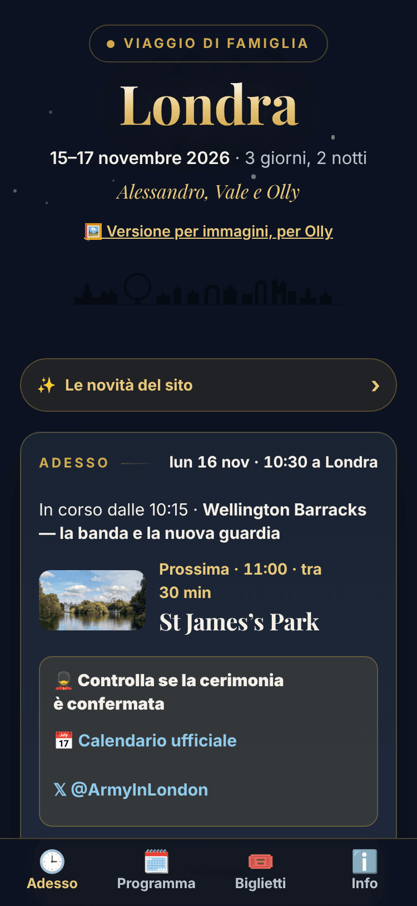 | 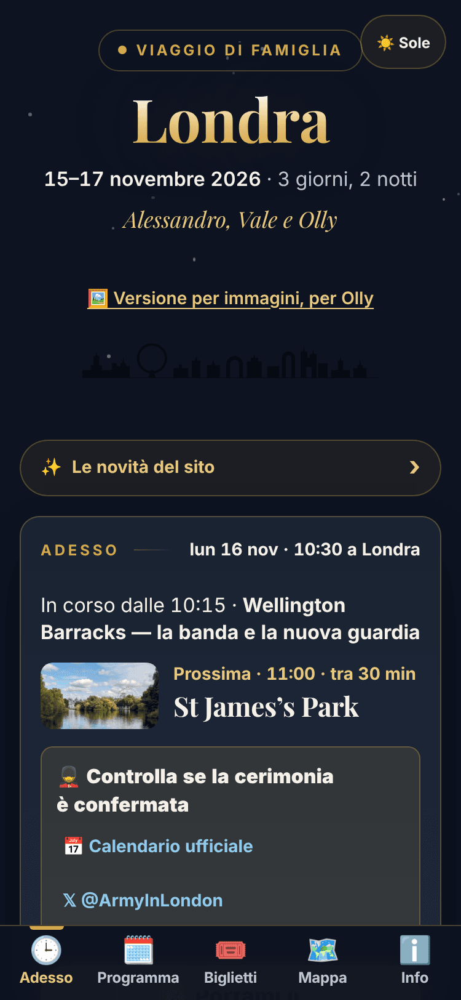 | 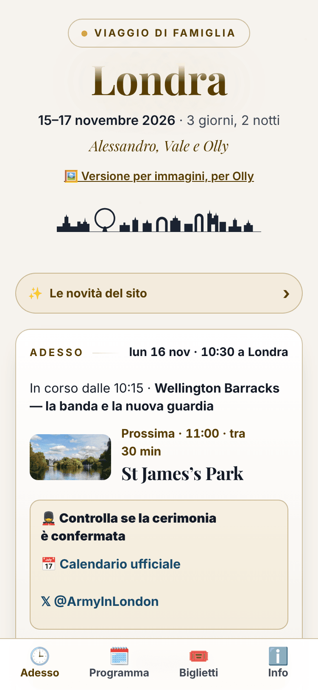 | 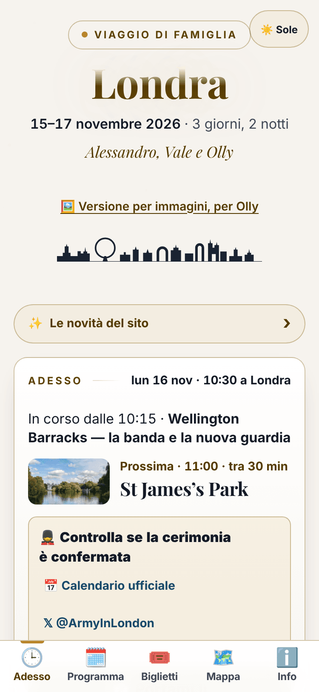 | 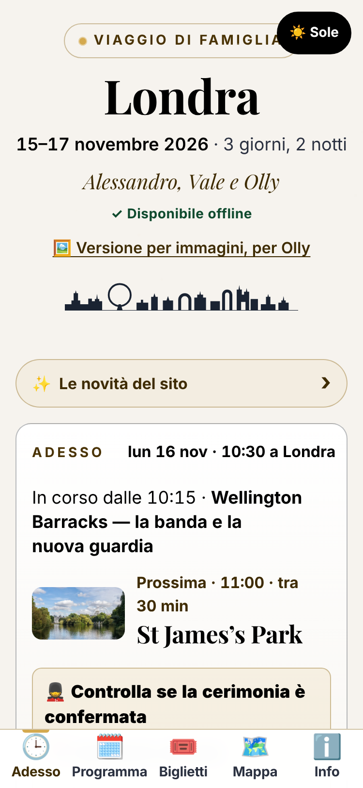 |
| Programma | 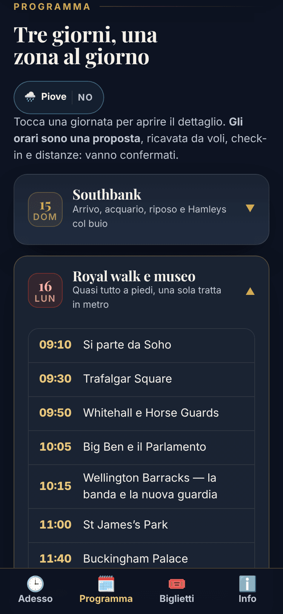 | 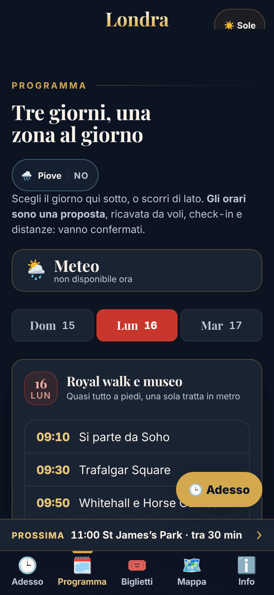 | 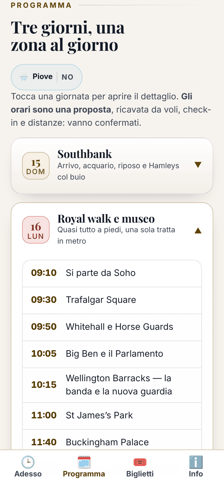 | 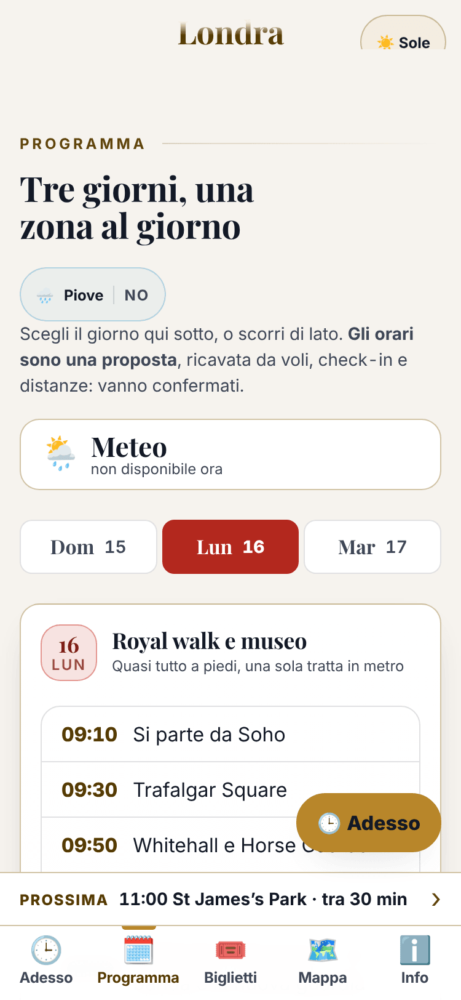 | 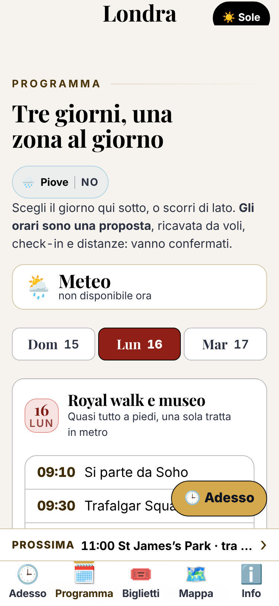 |
| Biglietti |  |  |  | 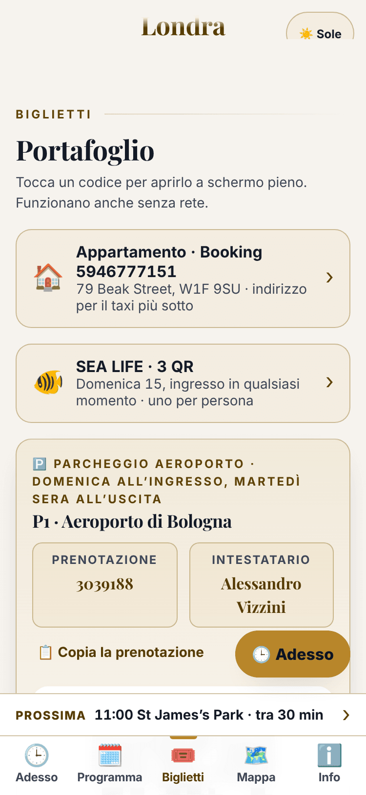 | 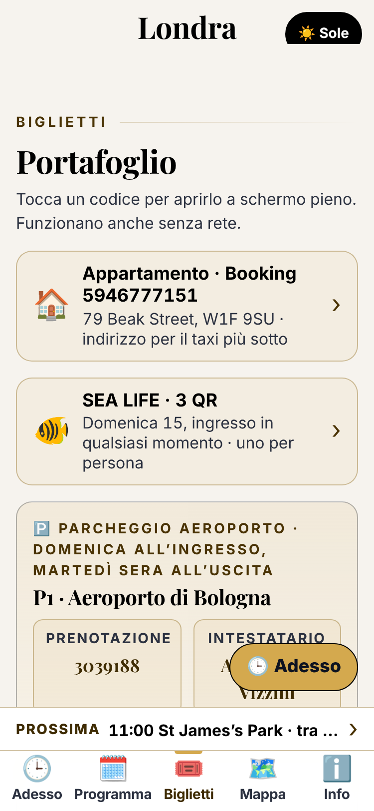 |
| Mappa | 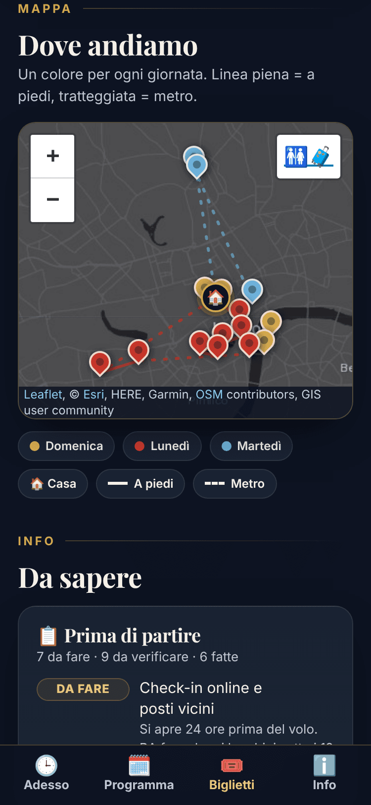 | 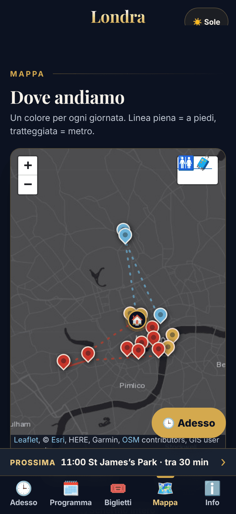 | 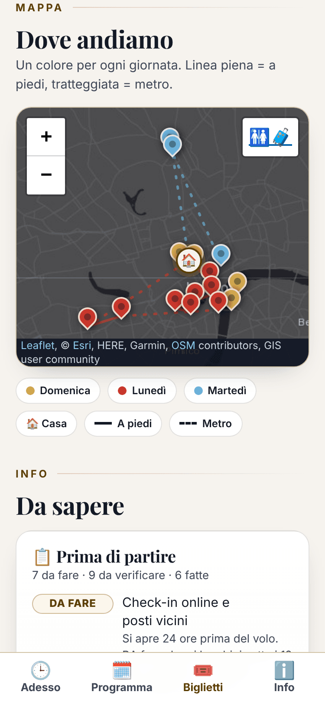 | 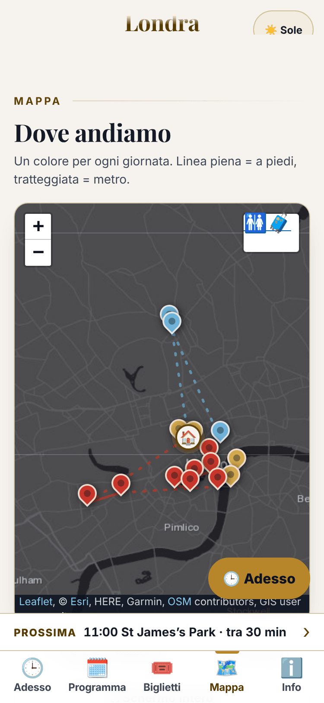 | 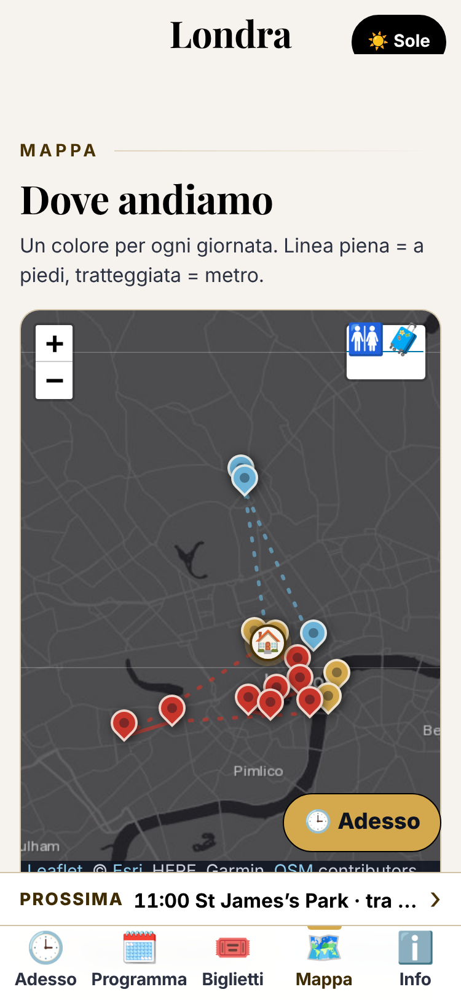 |
| Info | 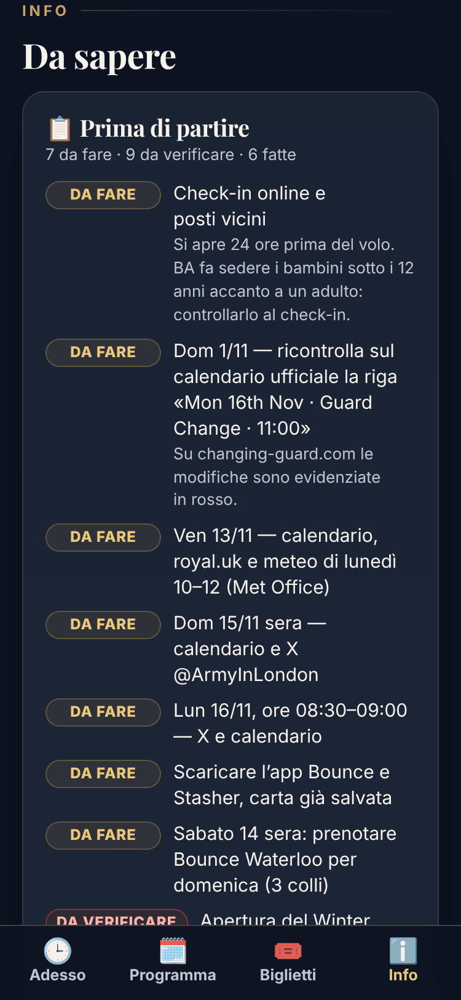 | 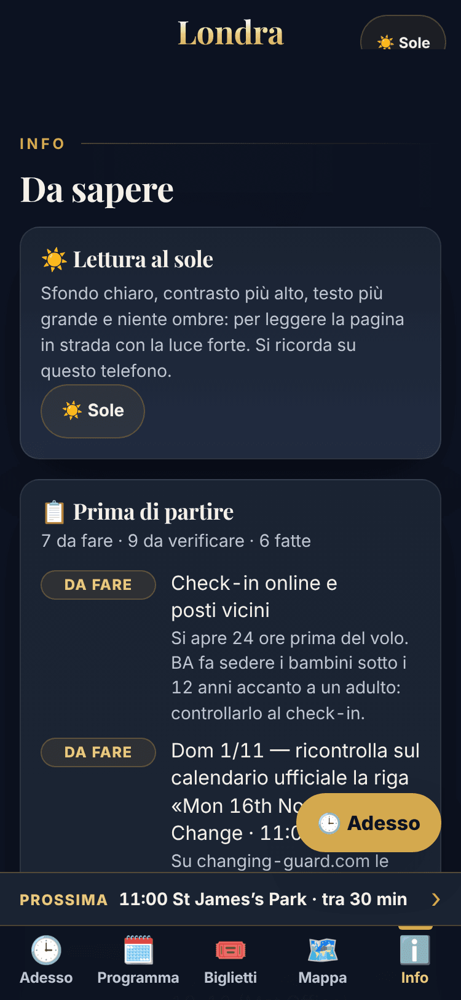 | 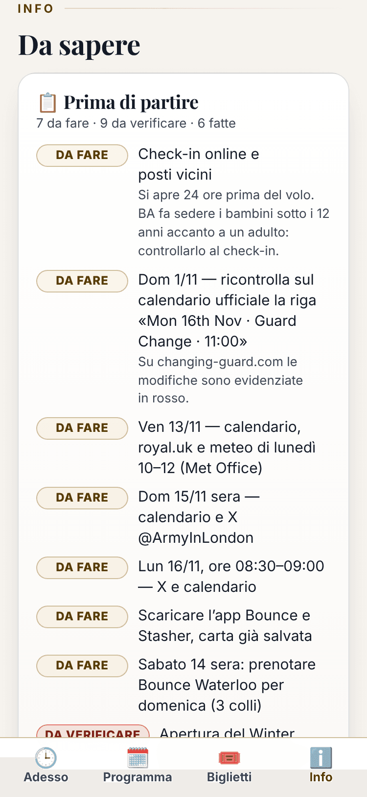 | 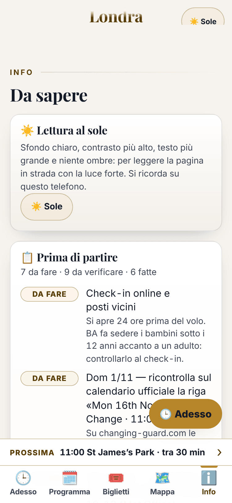 | 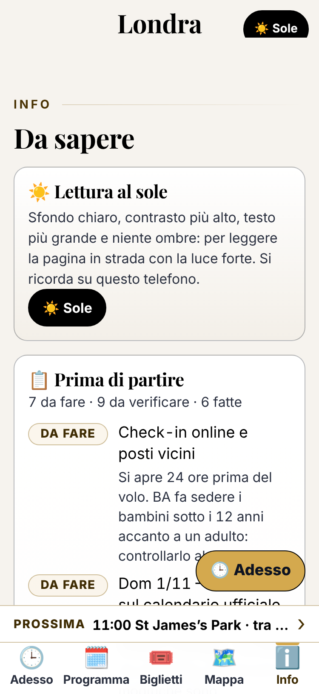 |

## Cosa resta da fare

- **Programma sotto le 8 schermate**: servirebbe una card più densa (foto a banda 2:1 o come miniatura per i trasferimenti, scaletta richiudibile). È una scelta di contenuto e di design da fare insieme, non l'ho presa da solo.
- **Note dei popup della mappa**: hanno ancora gli orari di lunedì precedenti al Cambio della Guardia (Trafalgar 09:45, Buckingham 11:05, St James's 11:15, Horse Guards 12:05, Big Ben 12:25). È contenuto: va allineato alle card con una modifica a parte.
- **Spazio sopra le viste**: fuori da Adesso la testata compatta lascia ancora un margine di qualche decina di px sopra il titolo della vista (`main` e `section` tengono i margini della pagina unica); si può stringere.
- **Pulsante flottante e striscia** fanno la stessa cosa fuori da Adesso: se la striscia basta, il pulsante può restare solo in Adesso oltre la prima schermata.
- **Lighthouse nel repo**: lo script lo cerca in `node_modules/lighthouse` o in `LIGHTHOUSE_DIR`; non è fra le dipendenze del progetto per non appesantire il deploy. Se serve in CI, va aggiunto come devDependency.
- **Sheet per i bagni e il meteo**, se si cambia idea sulla scelta di tenerli inline: il modulo `SHEET` è pronto, basta passargli il contenitore.
